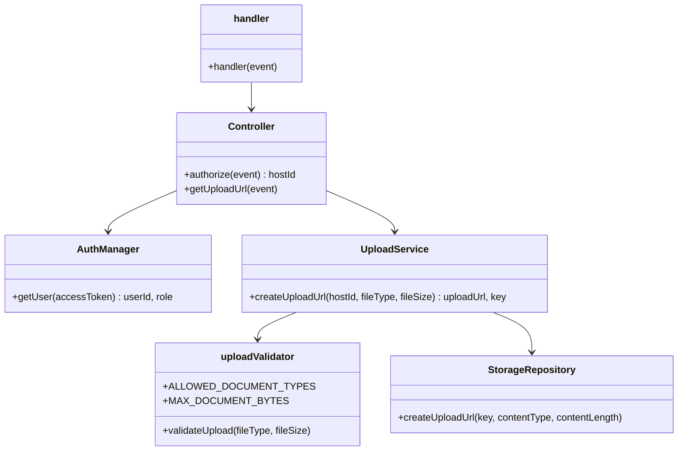

# Documents API

## Description
Lets a host store the documents of their business, such as contracts, permits and certificates, in the Owner Portal. This is the first part of the shared Document Lifecycle Management service. Today the API hands out a link to upload one file into the host's own folder. Saving the document, its versions, its links and its activity log follow in a later pull request (see [Planned](#planned)).

## Metadata
Lambda Function: `documents` (`backend/functions/documents/`, `metadata.json`)

Related Issue: #3870

Status: **In Development**

Database: tables `document`, `document_version`, `document_relationship` and `document_activity` in Aurora DSQL, created by hand, see the [document runbook](../../tools/dsql_document_runbook.md) and the [relationship and activity runbook](../../tools/dsql_document_relationship_activity_runbook.md). The upload link does not read or write them yet.

Storage: an S3 bucket whose name the Lambda reads from the environment variable `DOCUMENTS_BUCKET`. Files are named `documents/<host id>/<new id>.<extension>`.

## Base URL
All routes are served by one API Gateway resource that integrates the `documents` Lambda, deployed to the stage `default`. Find the base URL in the AWS console (region `eu-north-1`): API Gateway → the API that holds the `documents` integration → Stages → `default` → Invoke URL, followed by the resource path of that integration.

In this document `{baseUrl}` stands for that invoke URL plus resource path. Every route is selected by the HTTP method and the query parameter `action`. There are no sub-paths.

A deployed Lambda is not yet a usable endpoint. The resource, one `ANY` method with Lambda proxy integration, and an API deployment to `default` have to be set up in API Gateway by hand, because this repository has no infrastructure as code. `ANY` sends every method, including `OPTIONS`, to the Lambda: the router answers unknown methods with `405`, and the Lambda answers the CORS preflight itself. Do not enable CORS on the resource in API Gateway; that adds a separate `OPTIONS` method that takes precedence over `ANY`.

## Setup outside this repository
These are created by hand, once per environment:

| What | Detail |
| ---- | ------ |
| Lambda `documents` | In `eu-north-1`, the region of the Cognito user pool. The Cognito and S3 clients take their region from the Lambda's `AWS_REGION`. CI fails a pull request that changes this function while the Lambda does not exist |
| Environment variable `DOCUMENTS_BUCKET` | The name of the bucket. Without it, every upload-url request answers `500`, and the log says `DOCUMENTS_BUCKET is not set` |
| S3 bucket | In `eu-north-1`, the same region as the Lambda, because the link is signed for the Lambda's region. Private: all four public-access blocks are on. Versioning on. Default encryption SSE-S3 (`AES256`). CORS, copied from the task attachments bucket: `PUT` and `GET` from any origin with any header. Its name is not written here; it is the value of `DOCUMENTS_BUCKET` on the Lambda |
| IAM | The Lambda uses the shared `General-Lambda-Function` role, like the other Lambdas. That role has the AWS managed policy `AmazonS3FullAccess`, so the Lambda can write to the bucket, and so can every other function on the role. Limiting writes to the documents Lambda needs a dedicated role plus a bucket policy; that is a team-wide change, raised separately. The link carries the role's permission, so without it S3 refuses the upload |
| Checksums | The Lambda signs links with an S3 client set to `requestChecksumCalculation: "WHEN_REQUIRED"`. Without it, the SDK version in `backend/package-lock.json` adds `x-amz-checksum-crc32` with the checksum of an empty body to every link, and S3 refuses every real file with `400 BadDigest`. `storageRepository.signing.test.js` fails when a link carries any checksum parameter. Nothing to set up; kept here so the setting is not removed |
| API Gateway | See [Base URL](#base-url) |

## Working Endpoints

| Action | Description | Auth Required | Endpoint | Format |
| ------ | ----------- | ------------- | -------- | ------ |
| GET | Get a five-minute link to upload one file into the caller's folder | Yes (Host or Admin) | `{baseUrl}?action=upload-url&fileType={mime}&fileSize={bytes}` | [GET upload-url](./documents_upload_url_format.md) |
| OPTIONS | CORS preflight | No | `{baseUrl}` | [below](#options) |

## Planned
The next pull request adds the routes that use the tables. Their names and formats are not final:

| Capability | Status |
| ---------- | ------ |
| Save a document with its first version, after its upload | Planned |
| List the caller's documents, and read one | Planned |
| Add a new version of a document | Planned |
| Get a link to view or download a version | Planned |
| Archive a document | Planned |
| Link a document to a property, an owner or another entity, and remove that link | Planned |
| Read the activity log of a document | Planned |

## Security & Authorization
Every route except `OPTIONS` starts with the same check in the controller:

1. The `Authorization` header (or `authorization`) must hold a Cognito access token, without a `Bearer` prefix. The Lambda resolves it with Cognito `GetUser`.
   - No header: `401` `No authorization token provided.`
   - Cognito refuses the token (`NotAuthorizedException`, `UserNotFoundException`), or returns no username: `401` `Invalid or expired authorization token.`
   - Any other Cognito failure, such as throttling or an outage, is not a problem with the token: it is logged and answers `500` with the generic message.
2. The user's `custom:group` attribute must be `Host` or `Admin`, exactly. Any other group, or no group: `403` `You must be a Host or Admin to manage documents.`
3. The host is the Cognito `Username` of the caller. It is never read from the query or the body. Query parameters such as `hostId`, `host_id` or `asHostId` are ignored.

An `Admin` has no extra rights. An Admin's own `Username` is used as the host, so an Admin uploads into their own folder, not another host's. Co-hosts (team members acting for a host) are not supported.

## Calculation / Logic Overview

### Routing and 405
The router picks a route from the method and the `action` query parameter. It runs before the authorization check.

| Method | `action` | Route |
| ------ | -------- | ----- |
| GET | `upload-url` | upload link |
| OPTIONS | any | CORS preflight |

Every other combination answers `405` `Method not allowed.` without calling Cognito: any other method, `GET` without an `action`, and an unknown `action` or one in another case (`UPLOAD-URL`). Other query parameters are ignored.

### OPTIONS
Answers `200` with the CORS headers and no body, for any query.

### Design notes
The code holds no comments; these are the reasons behind its less obvious choices.

- **The server names the file.** `UploadService` builds `documents/<host id>/<new id>.<extension>` itself, so a caller can only ever create a new object in its own host's folder, and never choose or overwrite another key.
- **Signed type and size.** `StorageRepository` signs `content-type` and `content-length` (`SIGNED_UPLOAD_HEADERS`), so S3 refuses a `PUT` whose type or size differs from what the validator accepted. With `ContentLength` set, the SDK signs `content-length` even when it is not listed; it stays in the list to state the intent. `content-type` is only signed because it is listed.
- **No checksum in the link.** See the Checksums row in [Setup outside this repository](#setup-outside-this-repository).
- **Region from the environment.** The Cognito and S3 clients are created without a region, so they take `AWS_REGION` from the Lambda. That is why the Lambda, the user pool and the bucket all have to be in `eu-north-1`.
- **Which Cognito errors are a 401.** Only `NotAuthorizedException` and `UserNotFoundException` (`REFUSED_TOKEN_ERRORS` in `authManager.js`) mean the token was refused. Throttling or an outage is not the caller's fault, so it surfaces as a logged `500`, not as a `401` that would send the user to sign in again.
- **Constants waiting for confirmation.** `ALLOWED_DOCUMENT_TYPES` and `MAX_DOCUMENT_BYTES` are one constant each, so the list and the limit are a one-line change; the refusal messages are built from them.
- **Dummy credentials in the signing test.** `storageRepository.signing.test.js` replaces `process.env` with example credentials, a region and a bucket name. The link is signed locally and never sent, so no real account is involved.

## Common responses

Every response, including errors, carries these headers:

```
Access-Control-Allow-Origin: *
Access-Control-Allow-Methods: GET,OPTIONS
Access-Control-Allow-Headers: Content-Type,Authorization
```

Error responses have the body `{ "message": "String" }`. Map on the status code, not on the message.

| Status | Message | When |
| ------ | ------- | ---- |
| 401 | `No authorization token provided.` | no `Authorization` header |
| 401 | `Invalid or expired authorization token.` | Cognito refuses the token |
| 403 | `You must be a Host or Admin to manage documents.` | the caller's group is not `Host` or `Admin` |
| 405 | `Method not allowed.` | see [Routing and 405](#routing-and-405) |
| 500 | `Something went wrong, please contact support.` | any unexpected error, including a missing `DOCUMENTS_BUCKET`. Details are logged, never returned |

The [upload-url format](./documents_upload_url_format.md) lists the `400` answers.

## Class Diagram



## Where the code is

| Layer | File |
| ----- | ---- |
| Routing | `backend/functions/documents/index.js` |
| Auth | `auth/authManager.js` |
| Controller | `controller/controller.js` |
| Business | `business/service/uploadService.js`, `business/validation/uploadValidator.js` |
| Data | `data/storageRepository.js` |
| Util | `util/http/response.js`, `util/constant/responseHeader.json`, `util/exception/*` |
| Tests | `backend/test/documents/index.test.js`, `controller.test.js`, `authManager.test.js`, `uploadValidator.test.js`, `storageRepository.signing.test.js` |

## Todo & Improvements
- The accepted types and the 25 MB limit wait for product confirmation. Each is one constant in `uploadValidator.js` (`ALLOWED_DOCUMENT_TYPES`, `MAX_DOCUMENT_BYTES`); the refusal messages are built from them.
- Nothing confirms on the server that an upload arrived, or that its size matches. Saving a document (planned) has to check the object before it writes a version row.
- A file that is uploaded but never saved as a document stays in storage.
- There is no web client yet.
