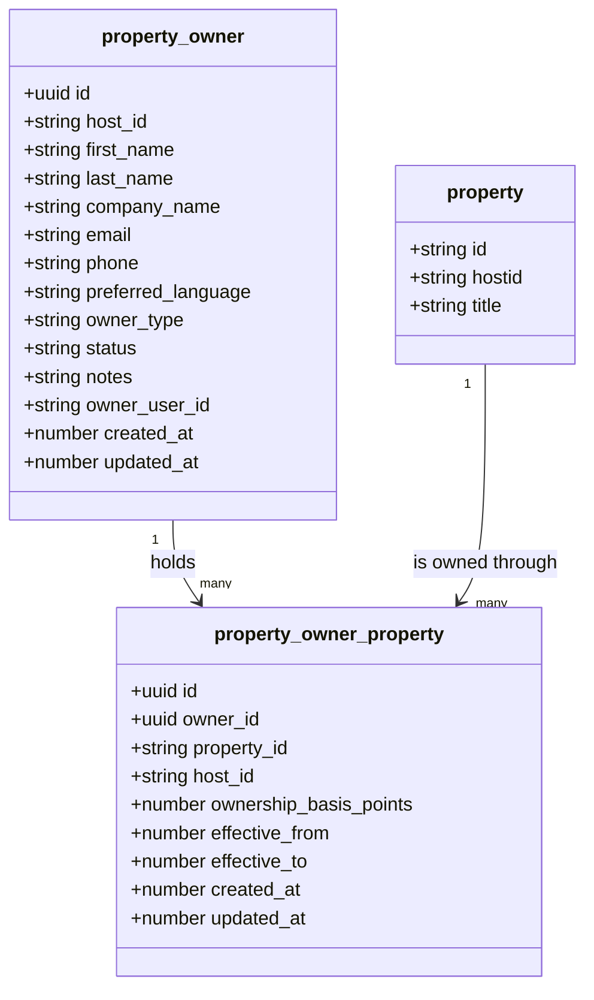
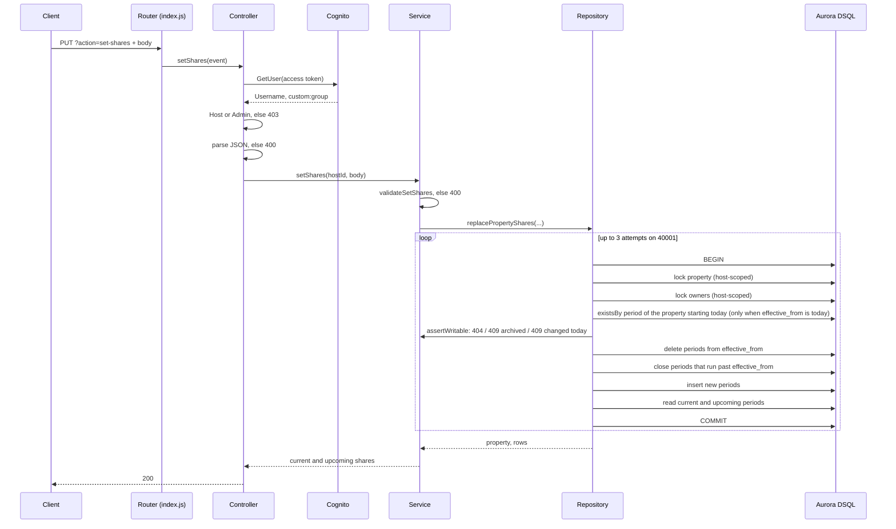

# Property owners API

## Description
Lets a host keep a register of the legal owners of their properties, and record which share of each property every owner holds over time. A host can list, read, create, update and archive owners, and set the ownership shares of one property from a given date.

## Metadata
Lambda Function: `property-owners` (`backend/functions/property-owners/`, `metadata.json`)

Related Issue: #3239

Status: **In Development**

Database: tables `property_owner` and `property_owner_property` in Aurora DSQL. They are created by hand, see the [property owner migration runbook](../../tools/dsql_property_owner_runbook.md).

## Base URL
All routes are served by one API Gateway resource that integrates the `property-owners` Lambda, deployed to the stage `default`. Find the base URL in the AWS console (region `eu-north-1`): API Gateway → the API that holds the `property-owners` integration → Stages → `default` → Invoke URL, followed by the resource path of that integration.

In this document `{baseUrl}` stands for that invoke URL plus resource path. Every route is selected by the HTTP method and the query parameters `id` and `action`. There are no sub-paths.

A deployed Lambda is not yet a usable endpoint. The resource, one `ANY` method with Lambda proxy integration, and an API deployment to `default` have to be set up in API Gateway by hand, because this repository has no infrastructure as code. `ANY` sends every method, including `OPTIONS`, to the Lambda: the router answers unknown methods with `405`, and the Lambda answers the CORS preflight itself. Do not enable CORS on the resource in API Gateway; that adds a separate `OPTIONS` method that takes precedence over `ANY`.

## Working Endpoints

| Action | Description | Auth Required | Endpoint | Format |
| ------ | ----------- | ------------- | -------- | ------ |
| GET | List the caller's owners with their current properties | Yes (Host or Admin) | `{baseUrl}` | [GET](./property_owners_get_format.md#list-owners) |
| GET | Read one owner with their current properties | Yes (Host or Admin) | `{baseUrl}?id={ownerId}` | [GET](./property_owners_get_format.md#read-one-owner) |
| POST | Create an owner | Yes (Host or Admin) | `{baseUrl}` | [POST](./property_owners_post_format.md) |
| PATCH | Update fields of an owner, including restoring an archived owner | Yes (Host or Admin) | `{baseUrl}?id={ownerId}` | [PATCH](./property_owners_patch_format.md#update-an-owner) |
| PATCH | Archive an owner | Yes (Host or Admin) | `{baseUrl}?action=archive&id={ownerId}` | [PATCH](./property_owners_patch_format.md#archive-an-owner) |
| PUT | Set all ownership shares of one property from a date | Yes (Host or Admin) | `{baseUrl}?action=set-shares` | [PUT](./property_owners_put_set_shares_format.md) |
| OPTIONS | CORS preflight | No | `{baseUrl}` | [below](#options) |

## Security & Authorization
Every route except `OPTIONS` starts with the same check in the controller, before the request body is read:

1. The `Authorization` header (or `authorization`) must hold a Cognito access token, without a `Bearer` prefix. The Lambda resolves it with Cognito `GetUser`.
   - No header: `401` `No authorization token provided.`
   - Cognito rejects the token, or any other Cognito error: `401` `Invalid or expired authorization token.`
2. The user's `custom:group` attribute must be `Host` or `Admin`. Any other group, or no group: `403` `You must be a Host or Admin to manage property owners.`
3. The host is the Cognito `Username` of the caller. It is never read from the body or the query. A body that contains `host_id` is rejected with `400`.

Because a `403` or `401` comes first, a request from a caller without access never reaches body parsing. A malformed body from such a caller gets `401` or `403`, not `400`.

Every read and write is scoped to the caller's host. An owner or property that belongs to another host behaves exactly like one that does not exist: `404`.

An `Admin` has no extra rights. An Admin's own `Username` is used as the host, so an Admin manages their own register, not another host's.

## Calculation / Logic Overview

### Ownership periods
Each row of `property_owner_property` says that one owner holds one share of one property during one period.

- **Share:** `ownership_basis_points`, an integer from 1 to 10000, where 10000 is 100%. 2500 is 25%.
- **Start:** `effective_from`, epoch milliseconds at a UTC midnight. The period includes this day.
- **End:** `effective_to`, epoch milliseconds at a UTC midnight, or `null` while the period is open. The end is exclusive: a period with `effective_to` = 1 November has ended on 1 November.
- **Today** is the UTC midnight of the server clock at the time of the request. It is a UTC date, not the host's local date.
- A row is **current** on today when `effective_from <= today` and (`effective_to` is `null` or `effective_to > today`).
- A row is **upcoming** when `effective_from > today`.

Shares are changed only through [set-shares](./property_owners_put_set_shares_format.md). It replaces every share of one property from one date, and closes the periods that ran past that date, so earlier history is kept. The shares in one request add up to exactly 10000, or the list is empty to end all ownership from that date.

The ownership of a property can change at most once per UTC day: when a period of the property already starts today, a second change for today answers `409`, so choose tomorrow or later.

GET responses show only **current** periods. Upcoming periods are returned by set-shares only.

### Owner status
`status` is one of `active` (default), `inactive`, `pending` or `archived`.

- `archived` can only be set through the [archive route](./property_owners_patch_format.md#archive-an-owner). Create and update reject it.
- An owner can only be archived when they hold no current or upcoming share.
- An archived owner cannot receive shares. Set-shares answers `409`.
- An archived owner can still be read, listed and edited. Restoring is a normal update with `status` set to `active`, `inactive` or `pending`.

### Concurrency
Aurora DSQL uses optimistic concurrency. A transaction that loses a write conflict fails at commit with SQLSTATE `40001` (or `OC001` after a schema change). The Lambda reruns such a write up to 3 times in total, with a short random wait.

| Route | Rerun on conflict | When the conflict outlasts the retries |
| ----- | ----------------- | -------------------------------------- |
| PUT set-shares | whole transaction | `409` `The ownership of this property changed at the same time. Reload and try again.` |
| PATCH archive | whole transaction | `409` `This owner changed at the same time. Reload and try again.` |
| PATCH update | the update statement | `500` with the generic message |

Set-shares locks the property row and the rows of the owners in the request. Archive locks the owner row. Because both lock the same owner row, a set-shares that gives an owner a share and an archive of that owner cannot both succeed: one of them conflicts and reruns, then fails its own check.

Set-shares also answers `409` with the same ownership message when the database reports a unique violation (`23505`), such as a second open period for the same owner and property.

Update reads the owner, validates the change against it and then writes. A change made between that read and the write is not detected. This race is accepted.

### Routing and 405
The router picks a route from the method, the `action` query parameter and whether an `id` query parameter is present. It runs before the authorization check.

| Method | `action` | `id` present | Route |
| ------ | -------- | ------------ | ----- |
| GET | absent | no | list owners |
| GET | absent | yes | read one owner |
| POST | absent | no | create owner |
| PATCH | absent | yes | update owner |
| PATCH | `archive` | yes | archive owner |
| PUT | `set-shares` | no | set shares |
| OPTIONS | any | any | CORS preflight |

Every other combination answers `405` `Method not allowed.` without calling Cognito:

- any other method, such as `DELETE` or `HEAD`
- an unknown `action`, an `action` in another case (`ARCHIVE`), or an empty `action=`
- an `action` on a method that does not use it, such as `GET ?action=archive`
- an `id` where the route takes none (`POST ?id=…`, `PUT ?action=set-shares&id=…`)
- no `id` where the route needs one (`PATCH`, `PATCH ?action=archive`)

An `id` that is present but empty (`?id=`) counts as present. The route is chosen, and the service then answers `400` `A valid owner id is required.` Other query parameters are ignored.

### OPTIONS
Answers `200` with the CORS headers and no body, for any query.

## Common responses

Every response, including errors, carries these headers:

```
Access-Control-Allow-Origin: *
Access-Control-Allow-Methods: GET,POST,PUT,PATCH,OPTIONS
Access-Control-Allow-Headers: Content-Type,Authorization
```

Error responses have the body `{ "message": "String" }`. Map on the status code, not on the message.

| Status | Message | When |
| ------ | ------- | ---- |
| 400 | `Request body must be valid JSON.` | POST, PATCH update and PUT: the body is missing or is not valid JSON |
| 400 | `A valid owner id is required.` | `id` is not a UUID (any case) |
| 401 | `No authorization token provided.` | no `Authorization` header |
| 401 | `Invalid or expired authorization token.` | Cognito rejects the token |
| 403 | `You must be a Host or Admin to manage property owners.` | the caller's group is not `Host` or `Admin` |
| 405 | `Method not allowed.` | see [Routing and 405](#routing-and-405) |
| 500 | `Something went wrong, please contact support.` | any unexpected error. Details are logged, never returned |

The route pages list the remaining `400`, `404` and `409` answers.

## Class Diagram



There are no foreign keys. The service layer keeps the three tables consistent, see the [runbook](../../tools/dsql_property_owner_runbook.md).

## Sequence Diagram
Set the shares of a property (`PUT ?action=set-shares`):



## Request formats

- [GET: list owners and read one owner](./property_owners_get_format.md)
- [POST: create an owner](./property_owners_post_format.md)
- [PATCH: update and archive an owner](./property_owners_patch_format.md)
- [PUT: set the shares of a property](./property_owners_put_set_shares_format.md)

## Todo & Improvements

- No route reads the periods of a property, or upcoming periods. Only the set-shares response shows them.
- A write conflict that outlasts the retries on PATCH update answers `500`, where archive and set-shares answer `409`.
- The tables are created by hand. Check the status section of the [runbook](../../tools/dsql_property_owner_runbook.md) before calling the API on a schema.
