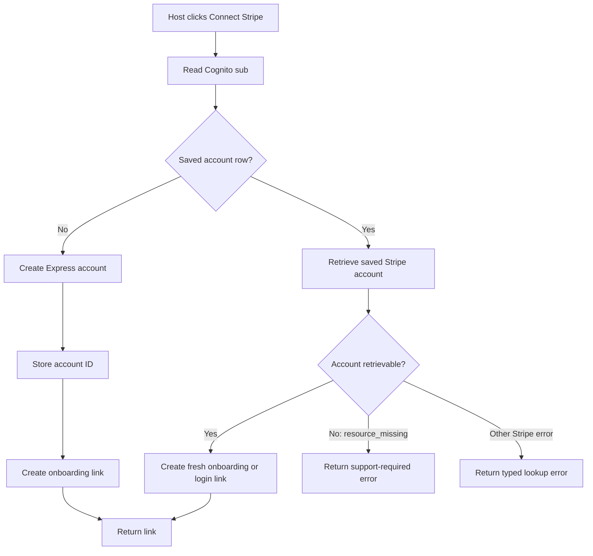

# Engineering review — Stripe legacy account recovery

## Scope

Review the existing Stripe Connect account flow for hosts whose Cognito identity already has a row in `main.stripe_connectedaccounts`. The goal is to make retries safe when a prior connection attempt created the Stripe account and saved its ID but did not leave the host with a usable onboarding or dashboard link.

Related historical issue: [#1054 — Stripe account connection creates multiple profiles on Stripe](https://github.com/domits1/Domits/issues/1054).

## Findings

### [P2] (confidence: 10/10) A saved account makes POST permanently return 409

**Evidence:** `backend/functions/general-crud-payment-handler/business/service/stripeAccountService.js` previously returned `ConflictException("Stripe account already exists")` whenever `getExistingStripeAccount(cognitoUserId)` found an account ID.

That prevents a host from retrying the flow if the Stripe account was created and persisted but the onboarding link creation failed, expired, or the browser did not complete the redirect. Every retry sees the same database row and returns 409 without checking whether the saved account can still be used.

**Resolution:** POST now checks and reuses the saved account. It retrieves the account and generates a fresh onboarding or login link. It only creates and inserts a new Stripe account when no saved account row exists. The existing database row is not overwritten.

### [P2] (confidence: 10/10) All Stripe failures were incorrectly reported as a missing account

**Evidence:** `buildStatusForStripeAccount` caught every exception from account retrieval and link creation and converted it into `NotFoundException` (HTTP 404). The frontend's `getStripeAccountDetails` treats every 404 as “no account” and returns `null`, so it cannot distinguish a missing database row from a Stripe API failure.

**Resolution:** An actual Stripe `resource_missing` response is now returned as HTTP 409 with code `STRIPE_ACCOUNT_NOT_FOUND`. Other account lookup and onboarding-link failures return distinct 502/503 errors. The Lambda logs only the Stripe error type, code, status and request ID; it does not log the account ID, Cognito subject or secret key.

### [P2] (confidence: 9/10) The host received no visible error when the connection action failed

**Evidence:** `frontend/web/src/features/hostdashboard/hostfinance/hooks/refreshFunctions.js` previously only called `console.error` in the Stripe action catch block.

**Resolution:** The frontend now reads the safe message and code returned by the API and displays the message through the existing Finance toast.

## Historical evidence

Issue #1054 contains a Stripe error from 23 September 2024: `Cannot create a login link for an account that has not completed onboarding.` The current code already has a fallback from login-link creation to a fresh onboarding link. This review does not assume that the current host is failing for the same exact Stripe error; the old issue demonstrates that partial onboarding and retry handling have caused this class of problem before.

## Architecture decision

A POST retry is idempotent with respect to the saved host-to-Stripe mapping:

- Existing row + retrievable account: reuse the account and issue a fresh link.
- Existing row + Stripe `resource_missing`: stop and return a support-required error.
- Existing row + temporary or link-generation failure: return a typed failure; do not create another account.
- No existing row: preserve the current new-account creation flow.

## Safety boundary / not in scope

- No database row is deleted or updated by this change.
- No existing Stripe account ID is replaced automatically.
- No new Stripe account is created when a saved row exists.
- No Stripe Dashboard, AWS environment variable, API Gateway deployment or live database operation is part of this code change.
- Replacing a genuinely inaccessible connected account remains a manual support decision after checking for balances, payouts and historical financial records.

## Tests

Added `backend/test/general-crud-payment-handler/stripeAccountService.test.js` covering:

- Existing saved account gets a fresh onboarding link without another account being created or inserted.
- Existing account can be retried even if Cognito no longer returns an email attribute.
- Failed login-link creation falls back to onboarding.
- Stripe `resource_missing` is distinct from a missing database row.
- Stripe availability errors are not converted into HTTP 404.
- A new account is created only when no saved row exists.

CI must pass before this change is considered ready to merge.
